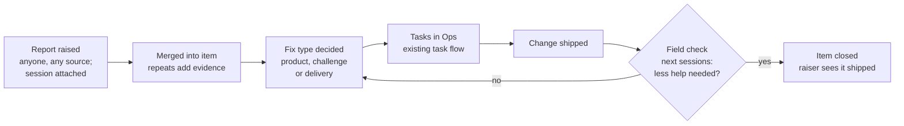

# Hard-Code Ops: Product Evolution Loop Implementation Plan

21 Nov 2026 · Owner: Shri (founder). Living version: https://claude.ai/artifact/Bcc2CNb7L7V1iqVDxyhUPy
Why: `docs/loop/STRATEGY.md`.

> **Next agent: do not write code for anything in this plan until the related questions in
> `docs/loop/OPEN_QUESTIONS.md` are answered by the founder.** Phase A (the existing `docs/BUILD_PLAN.md`
> Phase 0 and 1) is not blocked.

## Purpose and what we're building on

We add the product evolution loop to the Ops CRM as a connected layer, not a new app. Running a session,
raising an issue and checking a fix all happen in the same tool the office, workshop team and trainers use.

| Already built (schema `ops`) | Why it matters for the loop |
| --- | --- |
| `staff` with roles and departments, invite-only sign-in | Trainers, feedback team, camera team and office all live here |
| `institution` and the Institution 360 page | Every school and college is one record |
| `event` (school_workshop, college_workshop, stem_class, ...) with trainer, run sheet, `cohort` code | Starting point for sessions |
| `task` linked to any record (`entity_type`/`entity_id`) | Decided items become ordinary tasks |
| `feedback` inbox with sources | Raw reports already have a home |
| `ph_session`, `review_item`, `observation`, `insight` | Replays already become observations and grouped insights |
| `v_cohort_activation` | First product-usage measure per cohort |

State: DB written and tested, not yet applied to the ops Supabase project; Next.js app not started.

## Principles

- **Tasks stay tasks.** A decided item creates normal `task` rows. No separate tracker.
- **Feedback stays the inbox.** Every raw report (trainer note, visit note, survey, raised hand) lands in `feedback`.
- **Insights become the "item".** `insight` is what reports merge into, gets decided and is tracked to the field.
- **Link to PostHog, don't copy it.** Ops stores links, counts and tags.
- **Inventory stays out of the loop.** Trainers handle kits; a blocking kit problem is raised like any item.
- **Logging never competes with teaching.** In-class actions take one tap or nothing.
- **Kids' data stays minimal.** Roll number and first name in a class list; no email, no phone; IDE guardian-consent rules apply.

## What gets added

| Addition | What it is | Extends |
| --- | --- | --- |
| **Programmes and sessions** | A school lab or STEM class runs for months as a programme; each class meeting is a session (date, trainer, challenge + version, product version, attendance). Workshop days are sessions too. | `event` (today one block of days, no sessions inside) |
| **Class lists and teams** | Students per class by roll number + first name; teams at a station recorded per session. | `cohort` code (assumes individual sign-up) |
| **Challenge library** | Build challenges with version numbers; content stays in the founder's PDF/book. | New, small |
| **Raise an item** | One button anywhere (session, institution, mobile) for bug / feature request / issue / review, session attached automatically. | `feedback` |
| **Items to the field** | Reports merge into one item with a fix type (product, challenge, delivery), create tasks, close only after a field check. | `insight` + `task` |
| **Loop dashboards** | Help needed per challenge over weeks, usage per school, loop speed. | Product dashboard, `v_cohort_activation` |

The replay review queue stays, with new reasons: raised hand, team stuck on one step, same error repeating.

## Key workflows

**Running a school session**
1. Office schedules the session under the school's programme, with trainer, challenge and version.
2. Trainer opens the session in Ops on their phone; Ops shows a session code.
3. Teams enter the code on each machine and tap their names; trainer confirms teams and attendance.
4. During class, raised hands appear in the trainer's queue; trainer helps and taps "done".
5. After class, an optional quick note. PostHog, AI prompts and stuck signals attach by themselves.
6. On visit weeks, the feedback team logs observations against the same session.

College workshop days run the same way with individual sign-in by cohort code, plus camera-team recordings.

**From raised to checked**

The only new step compared with today's task flow is the field check.

## Who does what

| Who | In Ops as | Can do in the loop |
| --- | --- | --- |
| Founder | founder | Everything; final say on fix type; closes items after the field check |
| Office / ops team | member, Workshop or Sales | Set up programmes and sessions, keep class lists, chase stuck items |
| Trainers (ours, contracted) | member, Workshop + Training | Start sessions, mark attendance and teams, add notes, raise items |
| Feedback / quality team | member, Product + Workshop | Log visit observations, raise and merge items, review replays |
| Camera team | member, Workshop | Attach recordings to sessions |
| Product team | member or lead, Product | Decide with the founder, implement, run the field check |
| School teachers we train | **to decide** (OPEN_QUESTIONS Q1) | Raise items from their classroom |

Trainer notes and feedback-team observations store author and role so the two views stay separate.

## Changes needed in the IDE (Hard-Code Studio repo, not this repo)

1. **Class sign-in for schools:** session code from Ops; team taps names from the class list. No email or password.
2. **Tag everything:** every PostHog event and AI call carries institution, programme, session, station/team,
   product version. College/STEM users carry their cohort code (see `docs/INTEGRATIONS.md` section 4).
3. **Raise hand button:** trainer sees a queue on their phone; records step, last error, session.
4. **Stuck signals:** events for repeated compile failures, long idle on one step, the same error repeating.

AI prompts (through our key) are stored with the session tags.

## Phased rollout

Each phase starts only when the one before passes its gate. Dates are set once capacity is known.

| Phase | What ships | Gate |
| --- | --- | --- |
| A. Foundation | Existing `BUILD_PLAN.md` Phase 0 and 1 | One real workshop runs end to end in Ops |
| B. Sessions and class sign-in | Programmes, sessions, class lists, challenge library; IDE changes 1-2 | One school session with every event tagged to a team |
| C. Raise items, close in the field | Raise button, merge into items, fix type, field check step | First item closed after a field check |
| D. Automatic signals | Raise hand, stuck signals, AI prompts, new review reasons; IDE changes 3-4 | 4 weeks of help-needed data for one challenge in one school |
| E. Loop dashboards and scale | Dashboards; roll out to all schools, colleges, STEM classes | Loop speed reported weekly with no spreadsheet |

Phase B is the one that unlocks the loop.

## Notes for the next agent (proposals, confirm before building)

These are starting points only. Confirm each with the founder via `OPEN_QUESTIONS.md` first, then follow
`CLAUDE.md` (new migrations only, RLS on every table, tests in `tools/test-migrations.mjs`).

- Sessions: a new table under `event` (or a programme concept above it, see Q2), not new columns on `event`.
- Class lists: a roster table per institution class; minimal fields; no email/phone (DPDP).
- Feedback: add `session_id` and the new sources (trainer_note, visit, raise_hand, camera) via a migration.
- Insight: add fix type (product / challenge / delivery) and a field-check status between `shipped` and
  closed; decide whether `wont_fix` stays (Q3, Q4).
- Review reasons: extend the review-queue builder in `docs/INTEGRATIONS.md` section 2.
- Update `docs/DATA_MODEL.md`, `docs/BUSINESS_RULES.md`, `docs/DECISIONS.md` and `docs/HANDOFF.md` with every change.

## Risks and out of scope

| Risk | What we do about it |
| --- | --- |
| Trainers skip logging in busy classes | One-tap actions; visits and automatic signals cover gaps |
| Wrong team or session on data | Sessions opened from Ops, never typed by kids; trainer confirms teams |
| Patchy school Wi-Fi | Separate IDE concern; mark sessions with missing data instead of guessing |
| Kids' data and consent | Roll number + first name only; IDE consent rules; forget-user routine before scale |
| Too many raw reports | Merging into items and the review quota bound the load |
| Only loud, easy problems fixed | Track hard challenges separately on the dashboard |

Out of scope for now: inventory changes, school connectivity, own session replay, per-kid logins for schools
without devices, the syllabus content itself.
