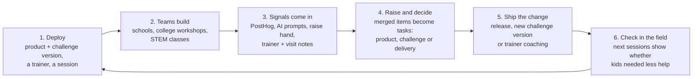

# Hard-Code: The Closed-Loop Evolution Strategy

21 Nov 2026 · Owner: Shri (founder). Living version: https://claude.ai/artifact/7UR9YJdCzokFJ1wCdFMioG
Audience: internal team. Implementation: `docs/loop/IMPLEMENTATION_PLAN.md`. Before building anything from
this, read `docs/loop/OPEN_QUESTIONS.md`.

## Why this matters

Our moat is not the IDE. It is the loop that keeps improving the IDE: real classrooms, our ops team and the
product connected so that every session tells us what to build, fix or teach next.

Anyone can build an AI hardware IDE. Tools like Schematik and Embedder see clicks. We will see clicks **and**
what happened in the room: which team got stuck, at which step, what the trainer did, and whether the next
week's session went better after we changed something.

Once the loop runs, we stop guessing what to build. Schools, colleges and STEM classes show us the problems;
the ops tool turns them into decided work; the next sessions prove whether the fix worked. Product and users
evolve together.

Institutions are not the end goal. They give us distribution, a controlled place to learn, and a community.
The public launch is built on top of what the loop has taught us.

## The loop

Three things evolve together: the product (Hard-Code Studio), the challenges we teach with, and how we
deliver them (trainers, session format, equipment). When something fails in a classroom, the fix can belong
to any of the three.

Step 6 is what makes this a loop rather than a ticket queue: a change is only done when the next sessions show
kids needed less help. Everything runs inside the Ops tool the team already uses, so running a session and
feeding the loop are the same work.

## Where the loop runs

Schools are where we learn fastest, colleges are where we prove it at scale, and STEM classes are where we
prove it pays.

| Surface | Shape | Our control | Role in the loop |
| --- | --- | --- | --- |
| School lab centres (3-4 to start) | Weekly classes, same kids for months; our trainer or a teacher we trained; weekly feedback-team visit | High: we can supply equipment, trainer and syllabus | **The lab.** Change something this week, see the result next week. Tracks the same kids over time. |
| College workshops | 60 engineers, 3-5 days straight; trainer, camera team and feedback team on site | Medium for the workshop, low after it | **Scale test.** Large samples show whether a fix holds outside our controlled schools. |
| College after the workshop | Students keep using the IDE, faculty run follow-ups, projects and competitions | Low | **Long-term signal and community.** Self-driven use with nobody watching is the honest test. |
| Private STEM classes | Same offer as schools, any mix of our equipment, trainer, syllabus and software | Varies by deal | **Commercial proof.** Same loop, paying customers. |

In schools, the reality is shared computers in a separate computer lab, often 8-16 working machines per class.
Kids work in teams of 2-4 at a station. We design for that, not against it.

## Who is in the loop

Everyone who touches a classroom is a sensor, and anyone can raise an item.

| Who | What they do in the loop |
| --- | --- |
| Trainers (ours and contracted) | Run sessions, help kids, add a quick note when something stands out. Helping comes first; logging is never their main job. |
| School teachers we train | Run sessions where we don't send a trainer; raise items from their classroom. |
| Feedback / quality team | Weekly school visits and on-site at workshops. Their view is **independent** of the trainer's, and the system keeps the two separate. |
| Camera team (workshops) | Records sessions; recordings attach to the session they came from. |
| Office / ops team | Schedules sessions, keeps institutions and people in order, makes sure items move. |
| Product team | Turns decided items into changes and checks them in the field. |
| Founder | Final say on what changes and where: product, challenge or delivery. |

A trainer reporting on their own sessions has a natural bias. The weekly independent visit is our honest signal.

## What the loop listens to

Most signals arrive on their own; people only add what machines can't see. Every signal is tagged with the
same context: institution, programme, session, team and product version.

| Signal | Comes from | What it tells us | Human effort |
| --- | --- | --- | --- |
| Session recordings, clicks, errors | PostHog (full capture, users consent at onboarding) | Exactly what a team did and where it broke | None |
| AI prompts and calls | Our supplied AI key | How kids describe what they want, and where the AI misunderstands them | None |
| Stuck patterns | Inferred: repeated compile failures, long idle on one step, the same error repeating | Where teams struggle, even when nobody says so | None |
| "Raise hand" requests | A button in the IDE that calls the trainer | The exact step and error where a team asked for help | One tap by the kids |
| Trainer notes | Quick note after or during a session | Patterns the trainer saw across the room | Occasional |
| Feedback-team observations | Weekly school visits, workshop days | Independent view of quality and process | Planned |
| Workshop recordings | Camera team | What happened in the room, for later review | Planned |
| Student and faculty feedback | Surveys, faculty follow-ups, community | What users themselves say | Light |

**The join is everything.** A recording is only useful when we can tie it to a team, a session, a school and a
product version. Because the IDE is our own code, we tag every user and session at sign-in.

Kids don't have email and machines are shared, so school students sign in simply: the trainer opens a session,
and each team taps their names from the class list. No passwords, no email. The team at a station is our unit
of measurement.

## The syllabus as a test harness

We are a tools company, not an edtech company. The syllabus exists to test the product, and success means the
product needs less of it over time.

- **Units are build challenges, not chapters.** "Make a plant that texts you when it's dry" is a unit.
- **Each challenge has a version**, so we know which sessions used which version.
- **The measure is help needed.** For the same challenge, fewer raised hands, fewer stuck patterns and less
  trainer help over time means the product is genuinely improving.
- **The syllabus should get thinner.** An edtech syllabus grows. Ours shrinks, because the product absorbs what
  used to need teaching.
- **Finished challenges become community projects** on the Explore page.

The syllabus content stays under the founder's separate control (today a PDF and a book). The loop only needs
to know which challenge and which version a session used.

## How we know it's working

| Measure | How we read it | Where it applies |
| --- | --- | --- |
| **Kids building on their own** | For the same challenge: raised hands per team, stuck patterns, time to first successful flash, challenges finished. Falling over weeks = working. | Schools most clearly; workshops too |
| **Product usage going up** | Active teams per session, compiles and flashes per session, return use across weeks | All surfaces |
| Use with nobody watching | Students using the IDE after a workshop, outside class, with no trainer | Colleges and STEM classes |
| Loop speed | Items raised, decided, shipped and checked in the field per week and month | Internal health |

We don't measure whether a trainer helped. We measure **where** help was needed. Loop speed starts slow on
purpose: monitor, log and track first; change counts per week or month are a dashboard, not a target.

## Why it compounds and why it's hard to copy

1. **Better product, less teaching.** Each fix removes a reason kids got stuck, so one trainer covers more classes.
2. **More classes, more evidence.** More sessions, more signals, the next problem found sooner.
3. **Evidence sells the next institution.** Real numbers on kids building on their own.
4. **Projects feed the community** we launch publicly with.

Hard to copy: physical presence in classrooms every week; ground truth tied to room, team, challenge and
trainer; months of history that can't be rebuilt later; and a free BYOK IDE that can sit in any lab.

## What the loop does not do

- It doesn't replace judgement. It surfaces and ranks problems; people decide where the fix belongs.
- It doesn't see bold ideas. Classrooms show today's pain; vision still comes from us.
- It can be fooled by easy wins. Watch hard challenges too.
- It needs clean tags. Wrong school, team or version is worse than no data.

Principles: help first, data second · kids' data handled with care (minimal data, guardian consent, DPDP) ·
reuse, don't rebuild · close the loop visibly (whoever raised an item sees it ship).

## Open questions

See `docs/loop/OPEN_QUESTIONS.md`.
